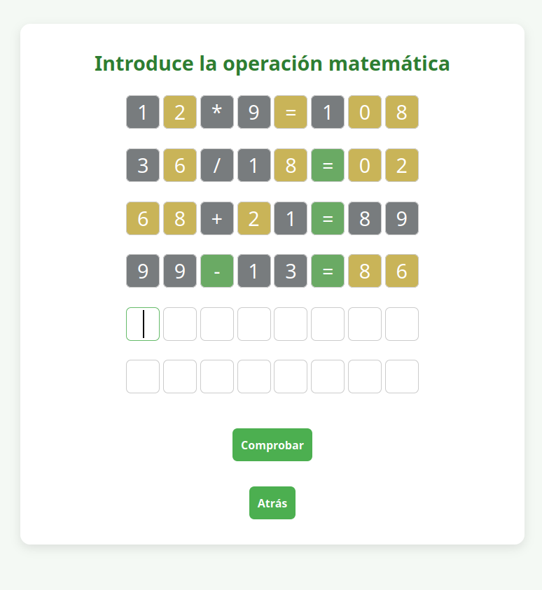
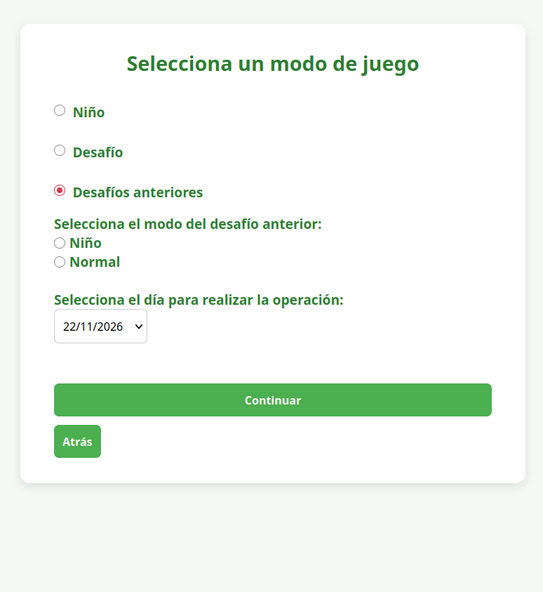
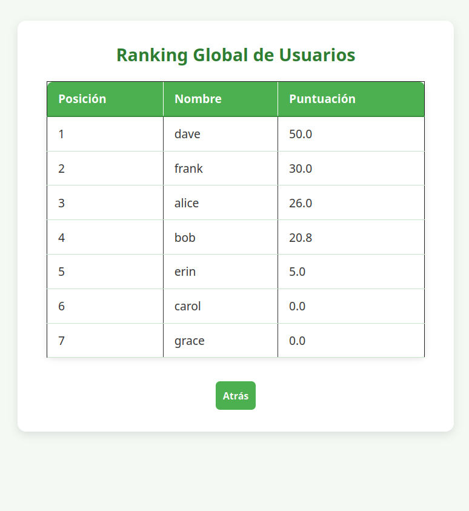

# Mathle

Web game inspired by [Nerdle](https://nerdlegame.com/), the maths version of Wordle. Each day there is a hidden equation, and players have **6 attempts** to find it. After each attempt, every character is coloured green (correct position), yellow (in the equation but in another position) or grey (not in the equation).

Built with **Java (Jakarta Servlets + JSP)**, **JavaScript** and **MariaDB**, as a team project for the Computer Engineering degree at the University of Córdoba.



## Features

- **Daily challenge:** a new equation every day for each game mode and difficulty, the same for every player. Equations are generated automatically and stored in the database.
- **Four difficulty levels:** equations of 6, 8, 10 or 12 characters.
- **Two game modes:** normal mode, and a kids' mode where part of the equation is already solved.
- **Previous days:** play the challenges from earlier dates.
- **Scoring system:** points depend on the number of attempts, the time taken and the difficulty.
- **Rankings:** a global leaderboard and a leaderboard for each daily challenge.
- **User accounts:** sign up and log in, with passwords hashed using bcrypt. Guests can also play without an account.
- **Message board** where players can post comments.
- **Four colour themes** (light, dark, blue and green), saved in each user's profile.
- **Tutorial** explaining how to play.

## Screenshots

| Game modes and previous days | Global ranking | Colour themes |
| --- | --- | --- |
|  |  |  |

## Architecture

- **View:** JSP pages, CSS and JavaScript (game board, colour feedback, timer)
- **Controller:** Jakarta Servlets that handle each action (login, game, rankings, messages, themes)
- **Data access:** DAO and DTO classes, with all SQL queries kept in `sql.properties` and run with `PreparedStatement`
- **Database:** MariaDB with tables for users, daily problems, games and messages

## Tech stack

Java · Jakarta Servlets · JSP · JavaScript · HTML · CSS · MariaDB · Maven · Apache Tomcat 10 · bcrypt

## Getting started

These steps are for Linux (Ubuntu/Debian).

1. **Install MariaDB and create the database.** The script installs MariaDB, sets a local `root` password (`1234`, for local development only) and creates the `mathle` database:
   ```bash
   sudo ./instalar_bbdd.sh
   ```
2. **Load the sample data** (tables, daily problems and demo users):
   ```bash
   sudo ./importar_bbdd.sh
   ```
3. **Build the project** with Maven:
   ```bash
   cd mathle
   mvn package
   ```
4. **Deploy** the generated `target/mathle.war` on Apache Tomcat 10 and open `http://localhost:8080/mathle`.

### Demo users

The sample data includes seven demo users, from `alice@example.com` to `grace@example.com`. All of them use the password `demo1234`.

## Team

Developed as a team project by José Trujillo Medina, Guillermo, Antonio, Manuel and Pablo.
